<div align="center">


### Đặt vé xe khách dễ dàng, an tâm mọi hành trình

Ứng dụng Android đặt vé xe khách: tìm chuyến, chọn ghế, thanh toán, quản lý vé điện tử, tích xu và hỏi đáp với trợ lý AI.

-3DDC84?logo=android&logoColor=white)


</div>

---

## Mục lục

- [Ảnh màn hình](#ảnh-màn-hình)
- [Tính năng](#tính-năng)
- [Điểm nổi bật](#điểm-nổi-bật)
- [Công nghệ](#công-nghệ)
- [Cấu trúc dự án](#cấu-trúc-dự-án)
- [Chạy thử](#chạy-thử)
- [Lộ trình](#lộ-trình)

---

## Ảnh màn hình

<table>
  <tr>
    <td align="center">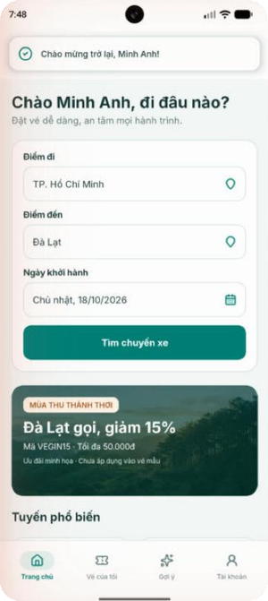<br /><sub><b>Trang chủ</b></sub></td>
    <td align="center">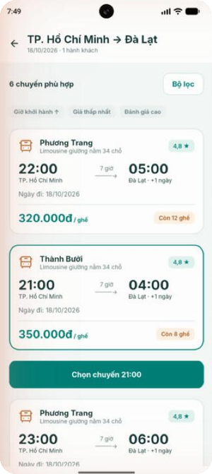<br /><sub><b>Danh sách chuyến</b></sub></td>
    <td align="center">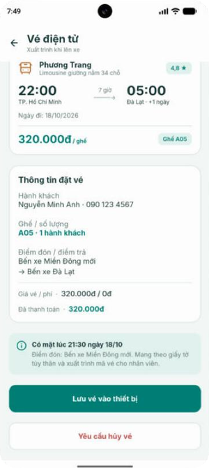<br /><sub><b>Vé điện tử</b></sub></td>
    <td align="center">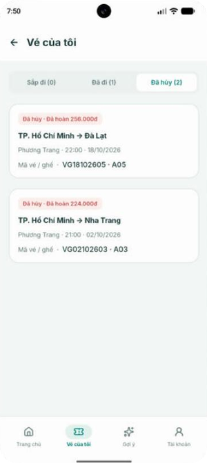<br /><sub><b>Vé của tôi</b></sub></td>
  </tr>
  <tr>
    <td align="center">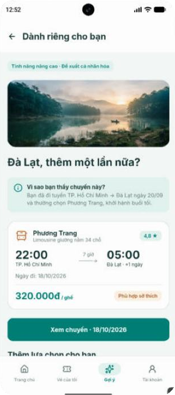<br /><sub><b>Gợi ý cá nhân hóa</b></sub></td>
    <td align="center">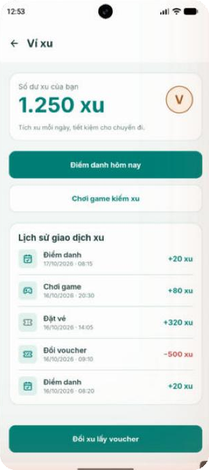<br /><sub><b>Ví xu</b></sub></td>
    <td align="center">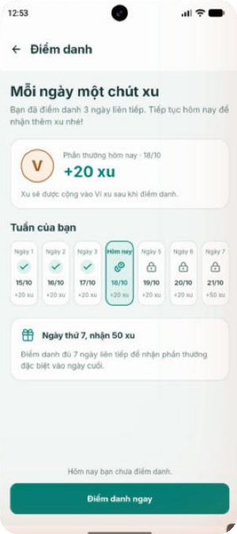<br /><sub><b>Điểm danh 7 ngày</b></sub></td>
    <td align="center">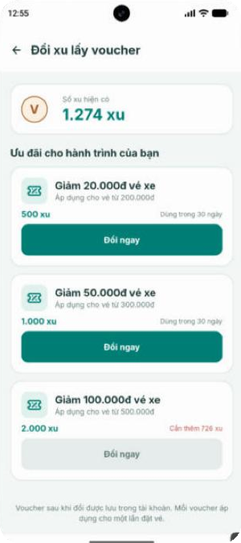<br /><sub><b>Đổi xu lấy voucher</b></sub></td>
  </tr>
  <tr>
    <td align="center">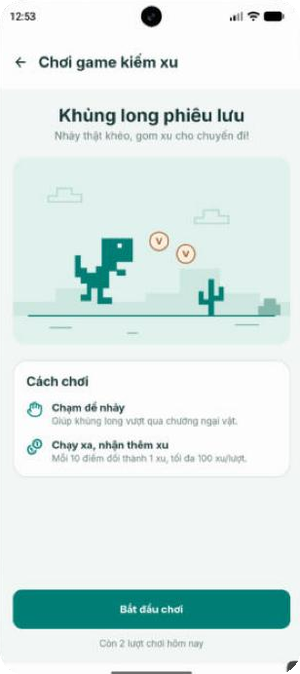<br /><sub><b>Game kiếm xu</b></sub></td>
    <td align="center">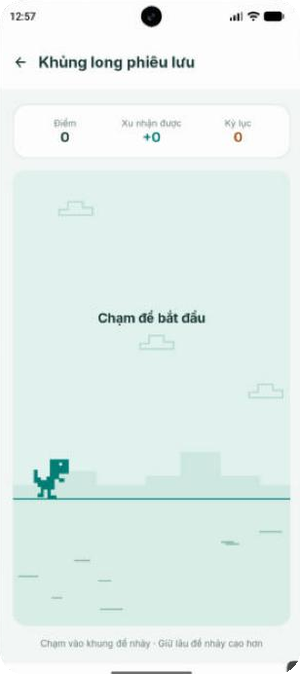<br /><sub><b>Khủng long phiêu lưu</b></sub></td>
    <td align="center">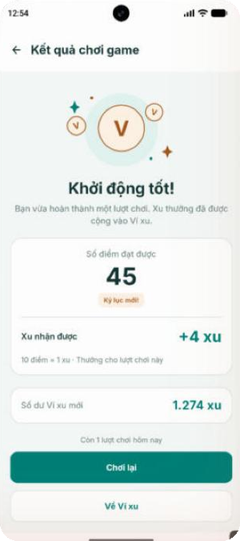<br /><sub><b>Kết quả lượt chơi</b></sub></td>
    <td align="center">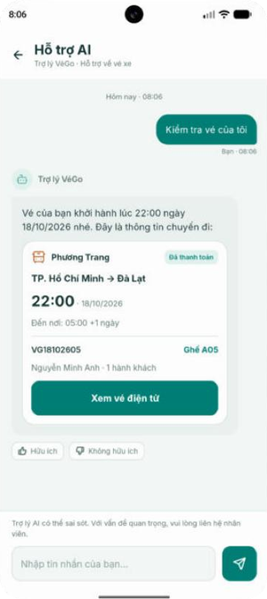<br /><sub><b>Trợ lý AI tra cứu vé</b></sub></td>
  </tr>
  <tr>
    <td align="center">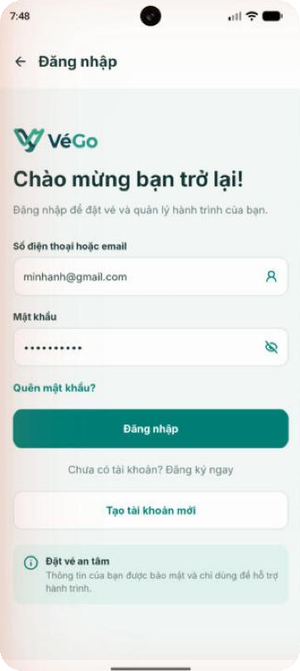<br /><sub><b>Đăng nhập</b></sub></td>
    <td align="center">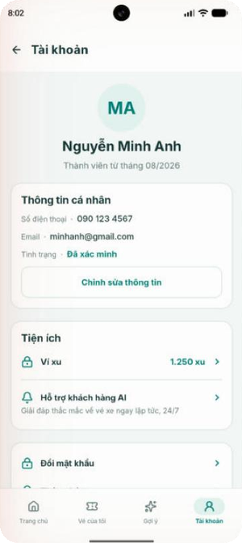<br /><sub><b>Tài khoản</b></sub></td>
    <td align="center">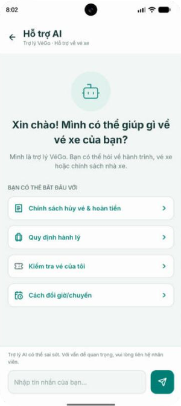<br /><sub><b>Hỗ trợ AI</b></sub></td>
    <td></td>
  </tr>
</table>

> Ảnh chụp trực tiếp từ app chạy trên máy ảo Pixel 8. Giao diện được dựng theo bản thiết kế Figma của dự án.

---

## Tính năng

| Nhóm | Màn hình | Có gì |
|:---:|---|---|
| **01** | Đăng nhập · Đăng ký · Quên mật khẩu · Trang chủ | Kiểm tra dữ liệu nhập, ẩn/hiện mật khẩu, chọn ngày đi, tuyến phổ biến, khuyến mãi |
| **02** | Tài khoản · Chỉnh sửa hồ sơ · Đổi mật khẩu | Đổi ảnh đại diện, hỏi lại khi rời đi mà chưa lưu, xác nhận đăng xuất |
| **03** | Tìm chuyến → Danh sách → Bộ lọc → Chi tiết → Chọn ghế → Hành khách → Xác nhận → Thanh toán → Kết quả | Sắp xếp và lọc chuyến, chọn chuyến rồi mới hiện nút "Chọn chuyến", sơ đồ ghế 2 tầng, giữ chỗ 5 phút có đếm ngược và cảnh báo, cổng thanh toán giả lập thành công/thất bại |
| **04** | Vé của tôi · Vé điện tử · Hủy vé · Đánh giá · Thông báo | Mã QR thật, lưu vé vào thư viện ảnh, tính tiền hoàn theo chính sách, đánh giá sao, đánh dấu đã đọc |
| **05** | Gợi ý · Dành riêng cho bạn | Gợi ý chuyến dựa trên lịch sử đi: cùng tuyến, cùng nhà xe, cùng buổi |
| **06** | Ví xu · Điểm danh · Game · Kết quả game · Đổi voucher | Chuỗi điểm danh 7 ngày, game chạy nhảy kiểu khủng long Chrome (10 điểm = 1 xu), đổi xu lấy voucher, đặt vé được cộng xu |
| **07** | Hỗ trợ AI | Câu hỏi nhanh, trả lời có ghi nguồn, tra cứu vé ngay trong chat, chuyển nhân viên (gọi hotline / gửi yêu cầu), đánh giá câu trả lời |

---

## Điểm nổi bật

- **Bám sát Figma.** Màu, cỡ chữ, khoảng cách, icon và hình minh họa lấy trực tiếp từ file thiết kế. Font Inter được đóng gói sẵn trong app.
- **Layout đúng yêu cầu môn học.** Toàn bộ giao diện chỉ phối hợp `RelativeLayout` và `LinearLayout`, khoảng cách dùng `divider` + `showDividers` thay vì margin rời rạc.
- **Pop-up thống nhất.** `VeGoDialog` có 4 loại (thành công, thông tin, cảnh báo, nguy hiểm) và `VeGoBanner` là thanh thông báo trượt từ trên xuống. Cả hai thay cho `Toast` và `AlertDialog` mặc định.
- **Chuyển màn có chủ đích.** Đi tiếp thì trượt ngang, đổi tab thì mờ dần, bảng lọc trượt từ dưới lên, màn kết quả phóng nhẹ từ giữa.
- **Game tự viết bằng Canvas.** Không dùng thư viện. Vòng lặp chạy theo `Choreographer` và tính theo thời gian thực, nên máy yếu vẫn chạy đúng tốc độ.
- **Trợ lý AI sẵn sàng cho RAG.** Bản hiện tại trả lời offline: tìm tài liệu chính sách phù hợp, chỉ trả lời dựa trên tài liệu đó và ghi nguồn; câu nào ngoài tài liệu thì chuyển nhân viên thay vì đoán. Lớp `SupportAssistant` đã tách riêng để sau này thay bằng lời gọi API tới server Gemini.
- **Ít phụ thuộc.** Ngoài AndroidX và Material, app chỉ dùng thêm ZXing core để tạo mã QR.

---

## Công nghệ

| Thành phần | Sử dụng |
|---|---|
| Ngôn ngữ | Java 11 |
| Nền tảng | Android 10 trở lên (minSdk 29), targetSdk 37 |
| Build | Gradle Kotlin DSL, Android Gradle Plugin 9.x, version catalog |
| Giao diện | XML Views, Material 3 theme, `RelativeLayout` + `LinearLayout` |
| Thư viện | AndroidX AppCompat, Activity, Material Components, ZXing core 3.5.3, Retrofit 2.11 + OkHttp 4.12 |
| Backend | Spring Boot 3.5 (Java 21), PostgreSQL 16 tự host, JWT, Flyway, Docker Compose + Caddy trên Azure VM — xem [`backend/README.md`](backend/README.md) |
| Kiểm thử API | Postman collection (`backend/postman/`), chạy tự động bằng Newman trên GitHub Actions |
| Thiết kế | Figma |

---

## Cấu trúc dự án

```text
app/src/main/java/com/example/vego/
├── auth/         Đăng nhập, đăng ký, quên mật khẩu
├── account/      Tài khoản, chỉnh sửa hồ sơ, đổi mật khẩu
├── booking/      Luồng đặt vé: tìm chuyến → thanh toán → kết quả
├── tickets/      Vé của tôi, vé điện tử, hủy vé, đánh giá, thông báo
├── explore/      Gợi ý chuyến cá nhân hóa
├── wallet/       Ví xu, điểm danh, voucher
│   └── game/     RunnerGameView — game khủng long vẽ bằng Canvas
├── support/      Màn hình chat Hỗ trợ AI
├── common/       BaseActivity, chuyển màn, mã QR, VeGoDialog, VeGoBanner
├── data/         Dữ liệu mẫu trong bộ nhớ: chuyến, vé, ví xu, thông báo
│   ├── api/      Retrofit: VeGoApi, ApiClient, tự gắn/làm mới token, ApiCallback
│   └── support/  SupportAssistant — trợ lý trả lời theo tài liệu
├── VeGoApp       Khởi tạo tầng gọi API
└── MainActivity  Trang chủ (dữ liệu từ GET /api/v1/home)

backend/          Server REST API (Spring Boot) — xem backend/README.md

app/src/main/res/
├── layout/       57 layout XML
├── drawable/     Icon vector xuất từ Figma, nền, hình minh họa
├── anim/         Hiệu ứng chuyển màn và hộp thoại
├── font/         Inter Regular / Medium / SemiBold / Bold
└── values/       Màu, kiểu chữ (styles), chuỗi tiếng Việt
```

> Đăng nhập, đăng ký, quên mật khẩu, hồ sơ, đổi mật khẩu và Trang chủ đã gọi REST API thật. Các phần còn lại (đặt vé, vé, ví xu...) vẫn dùng dữ liệu mẫu trong `data/` và sẽ được chuyển dần sang API.

---

## Chạy thử

**Yêu cầu:** Android Studio bản mới (hỗ trợ AGP 9.x), JDK 17+, máy ảo hoặc điện thoại Android 10 trở lên.

```bash
git clone https://github.com/dhuy-uit/VeGo.git
```

1. Mở thư mục `VeGo` bằng Android Studio và chờ Gradle sync xong.
   App gọi server theo khóa `vego.apiBaseUrl` trong `gradle.properties` (ghi đè được trong `local.properties`):
   server Azure, hoặc `http://10.0.2.2:8080/` khi chạy backend trên máy tính (`cd backend && docker compose up -d --build`).
2. Chọn máy ảo (ví dụ Pixel 8) rồi bấm **Run ▶**.
3. Màn đầu tiên là Đăng nhập, tài khoản mẫu đã điền sẵn, bấm **Đăng nhập** để vào app.

Hoặc build bằng dòng lệnh:

```bash
./gradlew assembleDebug        # Windows: gradlew.bat assembleDebug
```

---

## Lộ trình

- [x] **Giai đoạn 1 — Frontend:** dựng toàn bộ giao diện theo Figma, tương tác như prototype
- [x] **Backend + REST API:** Spring Boot trên Azure; xác thực JWT, hồ sơ người dùng, trang chủ; app gọi bằng Retrofit
- [x] **Cơ sở dữ liệu tự quản lý:** PostgreSQL chạy trong Docker trên máy ảo, không dùng dịch vụ database bên thứ ba
- [ ] **Chuyển các màn còn lại sang API:** tìm chuyến, đặt vé, vé của tôi, ví xu
- [ ] **Web admin:** quản lý chuyến, vé, người dùng và dashboard thống kê
- [ ] **RAG với Gemini:** trợ lý trả lời theo kho tài liệu chính sách, chạy phía server để máy cấu hình yếu vẫn dùng mượt

---

<div align="center">
<sub>Dự án học tập · Thực hiện bởi <a href="https://github.com/dhuy-uit">@dhuy-uit</a></sub>
</div>
